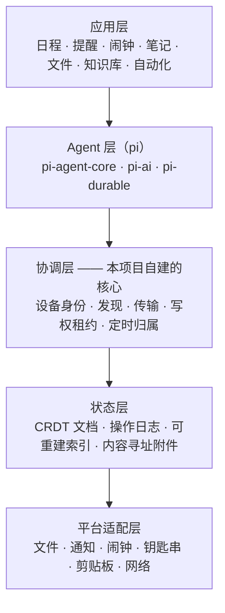
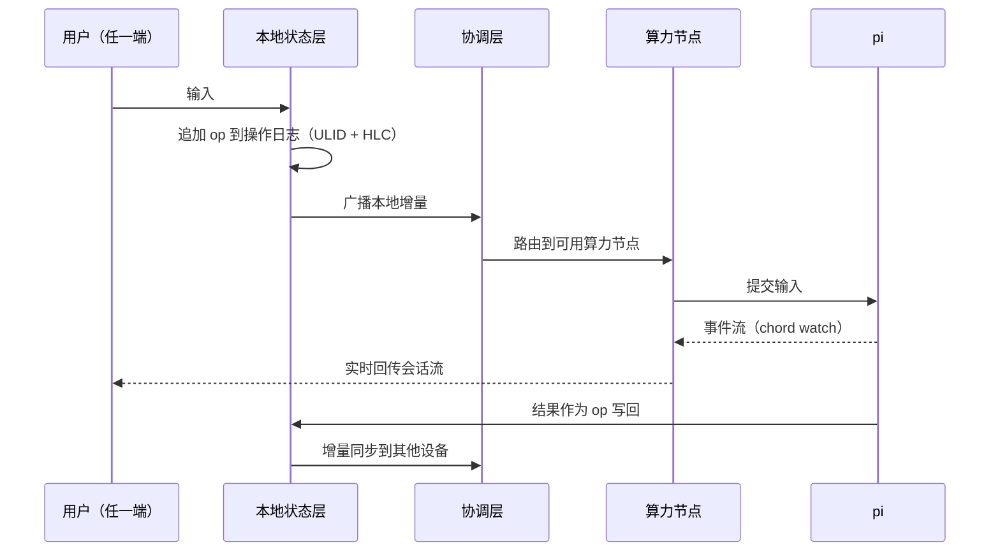
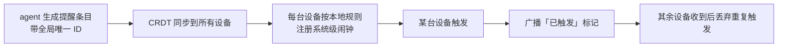
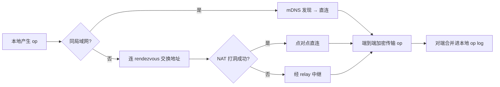

# 架构总览

## 一句话

Hello-ZhiXia（知夏生活 / HZX）是一个**跨平台、多设备自动同步、无中心数据服务器**的个人 agent 兼日常助手。

## 目标

1. **跨平台** — Windows、Linux、Android 三端，同一套数据、同一套能力
2. **多设备同步** — 任一设备上的改动，自动出现在其他设备上；各端持有完整结构化数据副本
3. **无中心数据服务器** — 用户数据不经过服务方；服务方至多接触加密流量与连接元数据
4. **安装即用** — 面向普通用户，不是极客工具
5. **日常助手** — 日程、提醒、闹钟、笔记、文件、知识库、自动化

## 非目标（明确排除）

明确排除的东西和要做的东西同样重要，它防止范围蔓延。

| 非目标 | 原因 |
| --- | --- |
| iOS 支持 | pi 没有任何 iOS 运行路径（见 [ADR-0002](./decisions/0002-target-platforms.md)） |
| 中心化 SaaS 多租户 | 各用户数据域独立，不存在「我们替你托管数据」的形态 |
| 端侧大模型作为默认推理路径 | 默认走云端 API（见 [ADR-0007](./decisions/0007-model-supply-and-credentials.md)） |
| 分布式强一致 | 分区容忍 + 可用性优先，接受最终一致（见 [ADR-0005](./decisions/0005-crdt-sync-basis.md)） |
| 跨设备同步「正在执行的 agent 任务」 | 本质不可同步；靠单写者租约规避，不试图合并 |

## 硬约束

以下不是设计选择，而是外部事实。任何架构方案都必须绕开或接受它们。

| 约束 | 来源 | 影响 |
| --- | --- | --- |
| pi 需要 Node.js ≥ 22.19 | pi 官方文档 | 决定了三端各自如何承载运行时 |
| pi **没有内置权限系统**，以启动进程的用户权限运行 | pi README 原文 | 权限门必须由本项目自己实现 |
| pi-durable：**一个进程同时独占一个 storage，没有跨进程锁** | pi-durable 文档原文 | 不能多设备共享同一份存储；写权必须串行化 |
| pi-durable 标注 **Experimental**，API 不保证兼容 | pi-durable 文档原文 | 必须在其上包一层抽象，隔离升级风险 |
| chord 的 watch 是**实时观看**语义：慢消费者最多缓存 100 帧，重连不回放 | chord / pi-durable 文档原文 | 不能拿它当离线同步协议 |
| pi 官方仅提供 Android/Termux 路径，Termux 是 CLI | pi 文档 | 移动端要么内置 Node，要么做瘦客户端 |
| Android 后台执行受系统严格限制 | 操作系统设计 | Android 无法承担常驻 agent 角色 |

## 架构分层

**各部分归属：**

- **应用层** — 本项目自建
- **Agent 层** — pi 提供（MIT 许可），本项目只做封装与工具注册
- **协调层** — 本项目自建，**这是真正的工作量所在**
- **状态层** — 本项目自建；复用 pi-durable 的存储原语但不依赖其同步语义
- **平台适配层** — 本项目自建，三端各自实现同一组接口

## 设备角色

| 角色 | 平台 | 持有数据 | 能否执行 agent | 常驻在线 |
| --- | --- | --- | --- | --- |
| 算力节点 | Windows / Linux | 全部结构化数据 + 按需内容 | ✅ 可以 | 在线时是 |
| 瘦客户端 | Android | 全部结构化数据 + 按需内容 | ❌ 不可以 | 不保证 |
| 见面点 | 服务方 VPS 或用户自建 | **不持有任何用户数据** | ❌ | 是 |

「任意一台关闭不影响整体」的准确含义：**状态可用性**由全量复制保证；**能力可用性**不保证——没有算力节点在线时，Android 只能读写本地数据，无法执行 agent。

## 关键数据流

### 一次对话

### 一次提醒（分布式最难的一环）

提醒**不由 agent 投递**。agent 只负责创建与修改提醒条目；投递交给操作系统。

这样把「恰好一次投递」从分布式系统里挪走——闹钟本来就该由用户手上那台设备负责响。

### 一次跨设备同步

## 安全模型

**信任边界**：见面点不可信（只允许它看到连接元数据与密文）；用户的每台设备可信；外部数据源（邮件、网页、第三方 API 响应）**完全不可信**。

| 面向 | 机制 |
| --- | --- |
| 设备身份 | 每设备一对 Ed25519 密钥，配对时交换公钥并人工确认（见 [ADR-0008](./decisions/0008-device-identity-and-pairing.md)） |
| 传输 | 端到端加密；见面点与中继均看不到明文 |
| 凭据 | 存放于操作系统钥匙串，经 E2E 通道在用户自己的设备间同步 |
| 工具权限 | **默认拒绝**，出站副作用需人工确认 |
| 导出与删除 | 用户可导出全部数据；删除走墓碑并需跨设备一致 |

### 主要攻击面：提示注入

当一个 agent 同时具备「读取私密数据」和「对外发起请求」两种能力时，风险不是相加而是**相乘**：一封邮件里嵌入的恶意指令，可以让 agent 把用户的笔记外发出去。

这是本项目**最现实的攻击面**，且没有一劳永逸的解法。缓解手段见 [open-questions.md](./open-questions.md#8-提示注入的缓解措施)。

## 风险清单

| 风险 | 类型 | 应对 |
| --- | --- | --- |
| pi-durable 处于 Experimental，API 可能破坏性变更 | 依赖 | 在存储之上包一层自有抽象，升级只改适配层 |
| 见面点成为单点故障 | 可用性 | 默认公共节点 + 可切换自托管（见 [ADR-0004](./decisions/0004-rendezvous-and-relay.md)） |
| 全量复制随数据量增长而不可持续 | 规模 | 结构化数据全量、二进制内容按需（见 [data-model.md](./data-model.md)） |
| 多设备并发副作用导致重复动作 | 正确性 | 写权租约 + 幂等键 |
| 提示注入导致数据外泄 | 安全 | 出站白名单 + 人工确认门 |
| LLM 成本失控 | 成本 | 配额与熔断，而非事后统计 |

## 下一步

未决问题集中在 [open-questions.md](./open-questions.md)。在动代码之前，其中标为 **P0** 的问题必须先有结论。
